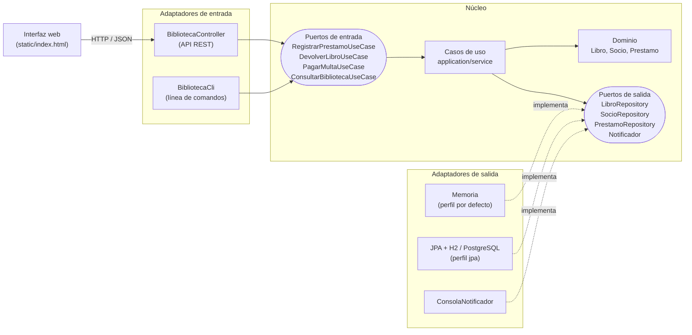

# Biblioteca hexagonal

Laboratorio 6 · Arquitectura de Software. Sistema de préstamos de una biblioteca construido con **arquitectura hexagonal (puertos y adaptadores)** en Java 17 y Spring Boot 3.

La idea que demuestra: las reglas del negocio viven en un núcleo de Java puro, y todo lo externo (HTTP, consola, base de datos, notificaciones) se conecta mediante adaptadores que se pueden cambiar sin tocar ese núcleo.

## Reglas del negocio

| Regla | Dónde vive |
| --- | --- |
| Un libro prestado no se puede volver a prestar | `Libro.prestar()` |
| Un socio puede tener como máximo 3 préstamos activos | `Socio.validarPuedePedirPrestamo()` |
| Un socio con multa pendiente no puede pedir libros | `Socio.validarPuedePedirPrestamo()` |
| Un préstamo vence a los 14 días | `Prestamo.registrar()` |
| Cada día de retraso genera S/ 1.00 de multa | `Prestamo.devolver()` |

Los valores (3, 14 y S/ 1.00) están en `PoliticaPrestamo`.

## Arquitectura



Todas las dependencias apuntan hacia el núcleo: los adaptadores de entrada **llaman** a los puertos de entrada y los adaptadores de salida **implementan** los puertos de salida.

La interfaz web queda **fuera** del hexágono: es un cliente más del adaptador REST, igual que curl o `requests.http`. No conoce los casos de uso ni el dominio. Solo hace peticiones HTTP y muestra lo que responde el servidor.

### Pieza por pieza

| Pieza | En el código |
| --- | --- |
| Entidades del dominio | `domain/model`: `Libro`, `Socio`, `Prestamo`, `PoliticaPrestamo` |
| Puertos de entrada | `domain/port/in`: `RegistrarPrestamoUseCase`, `DevolverLibroUseCase`, `PagarMultaUseCase`, `ConsultarBibliotecaUseCase` |
| Casos de uso | `application/service`: `RegistrarPrestamoService`, `DevolverLibroService`, `PagarMultaService`, `ConsultarBibliotecaService` |
| Puertos de salida | `domain/port/out`: `LibroRepository`, `SocioRepository`, `PrestamoRepository`, `Notificador` |
| Adaptadores de entrada | `infrastructure/in/web/BibliotecaController`, `infrastructure/in/cli/BibliotecaCli` |
| Adaptadores de salida | `infrastructure/out/persistence/memoria/*`, `infrastructure/out/persistence/jpa/*`, `infrastructure/out/notificacion/ConsolaNotificador` |
| Conexión de todo | `infrastructure/config/CasosDeUsoConfig` |
| Interfaz web (cliente de la API) | `src/main/resources/static/index.html` |

### Estructura de carpetas

```
src/main/java/pe/utec/biblioteca/
├─ domain/                  # Java puro: sin Spring, sin JPA
│  ├─ model/                # Libro, Socio, Prestamo, PoliticaPrestamo
│  ├─ exception/            # ReglaNegocioException, RecursoNoEncontradoException
│  └─ port/
│     ├─ in/                # casos de uso (interfaces)
│     └─ out/               # repositorios y notificador (interfaces)
├─ application/
│  └─ service/              # implementación de los casos de uso (Java puro)
└─ infrastructure/          # todo lo que depende de Spring
   ├─ config/               # CasosDeUsoConfig, DatosIniciales
   ├─ in/
   │  ├─ web/               # adaptador REST
   │  └─ cli/               # adaptador de consola
   └─ out/
      ├─ persistence/
      │  ├─ memoria/        # adaptador en memoria
      │  └─ jpa/            # adaptador JPA (entidades separadas del dominio)
      └─ notificacion/      # adaptador de notificaciones por consola
```

Decisiones a destacar:

- Los casos de uso **no tienen anotaciones de Spring**. Se crean a mano en `CasosDeUsoConfig`, que es el único lugar donde se "enchufan" los adaptadores.
- Las entidades JPA (`LibroEntity`, etc.) son **distintas** de las del dominio y se traducen en el adaptador. El dominio nunca ve una anotación `@Entity`.
- La fecha se obtiene de un `Clock` inyectado, así las pruebas pueden simular que pasaron 20 días.
- `ArquitecturaHexagonalTest` (ArchUnit) **verifica automáticamente** que el dominio y la aplicación no dependan de Spring ni de la infraestructura.

## Requisitos

- Java 17 o superior
- Maven 3.9+ (o IntelliJ IDEA, que ya lo incluye)
- Opcional: Docker, solo para usar PostgreSQL

## Cómo ejecutar

```bash
git clone https://github.com/fabio2152/biblioteca-hexagonal.git
cd biblioteca-hexagonal
mvn clean package          # compila y corre todas las pruebas
```

### 1. API REST con persistencia en memoria (por defecto)

```bash
java -jar target/biblioteca-hexagonal.jar
```

En el log aparece `Adaptador de persistencia activo: MemoriaLibroRepository`.

Abre **http://localhost:8080** para usar la interfaz web: lista de libros y socios, formulario de préstamo, devoluciones, pago de multas y un registro de cada llamada a la API con su código de respuesta. La interfaz no valida las reglas del negocio: si un préstamo no se permite, el `409` y su mensaje vienen del dominio.

Con los otros perfiles la interfaz sigue funcionando igual, porque solo depende de la API.

### 2. API REST con base de datos (H2 en archivo)

```bash
java -jar target/biblioteca-hexagonal.jar --spring.profiles.active=jpa
```

Ahora el log dice `Adaptador de persistencia activo: JpaLibroRepository`. **No cambió ni una línea del dominio.** Los datos se guardan en `./data` y sobreviven a reinicios. Las tablas se pueden ver en http://localhost:8080/h2-console (JDBC URL: `jdbc:h2:file:./data/biblioteca`, usuario `sa`, sin contraseña).

### 3. Línea de comandos (mismo núcleo, otro adaptador de entrada)

```bash
java -jar target/biblioteca-hexagonal.jar --spring.profiles.active=cli
```

Con `--spring.profiles.active=jpa,cli` la consola usa la misma base que la API, incluso al mismo tiempo: lo que se presta desde la consola aparece en `GET /api/libros`.

Comandos: `libros`, `socios`, `prestar S002 LIB-02`, `devolver LIB-01`, `prestamos S001`, `pagar S001`, `salir`.

> En Windows, si las tildes se ven mal en la consola, ejecuta `chcp 65001` antes.

### 4. Opcional: PostgreSQL

```bash
docker compose up -d
java -jar target/biblioteca-hexagonal.jar --spring.profiles.active=jpa,postgres
```

## API REST

| Método | Ruta | Qué hace |
| --- | --- | --- |
| GET | `/api/libros` | Lista los libros |
| GET | `/api/socios` | Lista los socios y su multa pendiente |
| GET | `/api/socios/{codigo}/prestamos` | Préstamos de un socio |
| POST | `/api/prestamos` | Presta un libro: `{"codigoSocio":"S002","codigoLibro":"LIB-02"}` |
| POST | `/api/devoluciones` | Devuelve un libro: `{"codigoLibro":"LIB-01"}` |
| POST | `/api/socios/{codigo}/pagos` | Paga la multa pendiente |

Respuestas de error: `409` si se viola una regla del negocio, `404` si no existe el socio o libro, `400` si faltan datos.

El archivo `requests.http` tiene todas las peticiones de la demo listas para ejecutar desde IntelliJ o VS Code (extensión REST Client). Con curl:

```bash
curl -X POST localhost:8080/api/prestamos -H "Content-Type: application/json" \
     -d '{"codigoSocio":"S002","codigoLibro":"LIB-02"}'
```

## Datos de ejemplo

Se cargan al arrancar si la base está vacía:

- Libros `LIB-01` a `LIB-06`. `LIB-01` (Clean Code) ya está prestado.
- `S001` Ana Torres: tiene `LIB-01` desde hace 20 días, así que está **vencido** y su devolución genera S/ 6.00 de multa.
- `S002` Bruno Díaz: sin préstamos ni multas.
- `S003` Carla Ruiz: tiene S/ 5.00 de multa pendiente.

## Guion de la demo

Los pasos 1 a 4 se pueden hacer desde la interfaz web en http://localhost:8080 o con `requests.http`.

1. Arrancar la API en memoria y mostrar `GET /api/libros`.
2. Prestar `LIB-02` a Bruno → `201`.
3. Intentar prestar `LIB-01` (ya prestado) → `409`. Intentar prestar a Carla (multa) → `409`. En la web, el aviso muestra el mensaje que devolvió el dominio.
4. Devolver `LIB-01` → multa de S/ 6.00 para Ana. Mostrar la notificación en el log.
5. **Cambiar el adaptador:** detener la app, arrancarla con `--spring.profiles.active=jpa` y mostrar en el log que ahora usa `JpaLibroRepository`. Repetir un préstamo y verlo en la consola H2.
6. **Otro adaptador de entrada:** con la API corriendo, abrir otra terminal con `--spring.profiles.active=jpa,cli`, prestar un libro y comprobarlo con `GET /api/libros`.
7. Ejecutar `mvn test` y mostrar que las pruebas del dominio corren sin servidor ni base de datos.

## Pruebas

```bash
mvn test
```

| Prueba | Qué demuestra |
| --- | --- |
| `domain/model/PrestamoTest`, `SocioTest` | Las reglas del dominio se prueban como Java puro |
| `application/service/CasosDeUsoTest` | Los casos de uso se prueban con adaptadores en memoria y un reloj fijo, sin Spring |
| `infrastructure/in/web/BibliotecaControllerTest` | La API REST de extremo a extremo |
| `arquitectura/ArquitecturaHexagonalTest` | ArchUnit verifica que se respete la regla de dependencias |

## Simplificaciones

Para mantener el ejemplo pequeño, los casos de uso no abren una transacción: cada adaptador JPA guarda por separado. En un sistema real se agregaría un puerto de transacción o se envolverían los casos de uso en la configuración.
